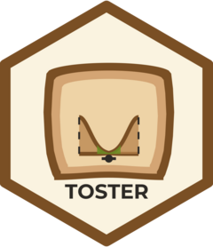

# TOSTER <a href="https://aaroncaldwell.us/TOSTERpkg"></a>

 <!-- badges: start -->
  [](https://github.com/Lakens/TOSTER/actions)
  [](https://app.codecov.io/github/Lakens/TOSTER?branch=master)
  [](https://cran.r-project.org/package=TOSTER)
  [](https://aaroncaldwell.us/TOSTERpkg/)
  <!-- badges: end -->
  


*An R package and jamovi module for equivalence testing*

TOSTER provides equivalence tests and minimal effect tests based on the two one-sided tests (TOST) procedure. It covers t-tests, correlations, differences in proportions, F-tests/ANOVA, and robust or nonparametric alternatives (bootstrap, permutation, Wilcoxon, Brunner-Munzel, and log-ratio tests). It also calculates standardized mean differences and rank-based effect sizes with confidence intervals, and power for equivalence tests. Equivalence bounds can be set on the raw scale or as standardized effect sizes.

Please see the package's [website](https://aaroncaldwell.us/TOSTERpkg/) for updates, vignettes, and other details about the package.

## Which function should I use?

| Task | Function(s) | Guide |
|---|---|---|
| Equivalence or minimal effect t-test (one-sample, paired, two-sample) from raw data | `t_TOST()` | [t_TOST](https://aaroncaldwell.us/TOSTERpkg/articles/IntroTOSTt.html) |
| The same t-tests from summary statistics (means, SDs, n) | `tsum_TOST()` | [t_TOST](https://aaroncaldwell.us/TOSTERpkg/articles/IntroTOSTt.html) |
| Estimate the paired-samples correlation needed by `tsum_TOST()` | `extract_r_paired()` | [reference](https://aaroncaldwell.us/TOSTERpkg/reference/extract_r_paired.html) |
| Equivalence test that returns a standard `htest` object | `simple_htest()` | [Hypothesis testing](https://aaroncaldwell.us/TOSTERpkg/articles/hypothesis_testing.html) |
| Print, plot, or describe `t_TOST()`/`wilcox_TOST()` results | `print()`, `plot()`, `describe()` | [t_TOST](https://aaroncaldwell.us/TOSTERpkg/articles/IntroTOSTt.html) |
| Convert TOSTER results to `htest`; tabulate, describe, or plot any `htest` | `as_htest()`, `df_htest()`, `describe_htest()`, `plot_htest_est()` | [Hypothesis testing](https://aaroncaldwell.us/TOSTERpkg/articles/hypothesis_testing.html) |
| Power or sample size for TOST t-tests | `power_t_TOST()` | [t_TOST](https://aaroncaldwell.us/TOSTERpkg/articles/IntroTOSTt.html) |
| Bootstrap TOST or bootstrap t-test for means | `boot_t_TOST()`, `boot_t_test()` | [Robust TOST](https://aaroncaldwell.us/TOSTERpkg/articles/robustTOST.html) |
| Permutation t-test (including equivalence alternatives) | `perm_t_test()` | [Robust TOST](https://aaroncaldwell.us/TOSTERpkg/articles/robustTOST.html) |
| Ratio of means (log-transformed TOST) | `log_TOST()`, `boot_log_TOST()` | [Robust TOST](https://aaroncaldwell.us/TOSTERpkg/articles/robustTOST.html) |
| Wilcoxon-Mann-Whitney / signed-rank TOST | `wilcox_TOST()` | [Robust TOST](https://aaroncaldwell.us/TOSTERpkg/articles/robustTOST.html) |
| Brunner-Munzel test (probability of superiority) | `brunner_munzel()` | [Robust TOST](https://aaroncaldwell.us/TOSTERpkg/articles/robustTOST.html) |
| Hodges-Lehmann test (location shift) | `hodges_lehmann()` | [Robust TOST](https://aaroncaldwell.us/TOSTERpkg/articles/robustTOST.html) |
| Rank-based effect sizes (rank-biserial, concordance, odds) and tests of them | `ses_calc()`, `boot_ses_calc()`, `boot_ses_test()` | [Robust TOST](https://aaroncaldwell.us/TOSTERpkg/articles/robustTOST.html) |
| Rank-difference transformation for paired data; rescale probability-scale effect sizes | `rank_diff()`, `trans_rank_prob()` | [reference](https://aaroncaldwell.us/TOSTERpkg/reference/index.html) |
| Equivalence test for a correlation (Pearson, Spearman, Kendall) from raw data | `z_cor_test()`, `boot_cor_test()` | [Correlations](https://aaroncaldwell.us/TOSTERpkg/articles/correlations.html) |
| Equivalence test for a correlation from summary statistics | `corsum_test()` | [Correlations](https://aaroncaldwell.us/TOSTERpkg/articles/correlations.html) |
| Compare correlations between independent studies | `compare_cor()`, `boot_compare_cor()` | [Correlations](https://aaroncaldwell.us/TOSTERpkg/articles/correlations.html) |
| Plot the uncertainty in a correlation | `plot_cor()` | [reference](https://aaroncaldwell.us/TOSTERpkg/reference/plot_cor.html) |
| Power for correlation equivalence tests | `power_z_cor()` | [Introduction](https://aaroncaldwell.us/TOSTERpkg/articles/IntroductionToTOSTER.html) |
| Equivalence test for two independent proportions | `twoprop_test()` | [reference](https://aaroncaldwell.us/TOSTERpkg/reference/twoprop_test.html) |
| Power for two-proportion equivalence tests | `power_twoprop()` | [reference](https://aaroncaldwell.us/TOSTERpkg/reference/power_twoprop.html) |
| Equivalence test for an F-test or ANOVA (partial eta-squared) | `equ_ftest()`, `equ_anova()` | [F-tests](https://aaroncaldwell.us/TOSTERpkg/articles/the_ftestTOSTER.html) |
| Power for F-test equivalence tests | `power_eq_f()` | [F-tests](https://aaroncaldwell.us/TOSTERpkg/articles/the_ftestTOSTER.html) |
| Plot the uncertainty in partial eta-squared | `plot_pes()` | [F-tests](https://aaroncaldwell.us/TOSTERpkg/articles/the_ftestTOSTER.html) |
| Standardized mean differences (Cohen's d, Hedges' g, Glass's delta) with CIs | `smd_calc()`, `boot_smd_calc()` | [SMDs](https://aaroncaldwell.us/TOSTERpkg/articles/SMD_calcs.html) |
| Plot the uncertainty in an SMD | `plot_smd()` | [SMDs](https://aaroncaldwell.us/TOSTERpkg/articles/SMD_calcs.html) |
| Compare SMDs between original and replication studies | `compare_smd()`, `boot_compare_smd()` | [SMDs](https://aaroncaldwell.us/TOSTERpkg/articles/SMD_calcs.html) |
| TOST for a meta-analytic effect size (legacy; no newer replacement) | `TOSTmeta()` | [Introduction](https://aaroncaldwell.us/TOSTERpkg/articles/IntroductionToTOSTER.html) |
| *Superseded:* legacy t-test TOST functions; use `t_TOST()` or `tsum_TOST()` | `TOSTone()`, `TOSTone.raw()`, `TOSTpaired()`, `TOSTpaired.raw()`, `TOSTtwo()`, `TOSTtwo.raw()` | [Introduction](https://aaroncaldwell.us/TOSTERpkg/articles/IntroductionToTOSTER.html) |
| *Superseded:* legacy correlation and proportion TOST; use `corsum_test()` or `twoprop_test()` | `TOSTr()`, `TOSTtwo.prop()` | [Introduction](https://aaroncaldwell.us/TOSTERpkg/articles/IntroductionToTOSTER.html) |
| *Superseded:* legacy power functions; use `power_t_TOST()`, `power_z_cor()`, or `power_twoprop()` | `powerTOSTone()`, `powerTOSTone.raw()`, `powerTOSTpaired()`, `powerTOSTpaired.raw()`, `powerTOSTtwo()`, `powerTOSTtwo.raw()`, `powerTOSTr()`, `powerTOSTtwo.prop()` | [Introduction](https://aaroncaldwell.us/TOSTERpkg/articles/IntroductionToTOSTER.html) |
| *Deprecated:* nonparametric effect sizes; use `ses_calc()` | `rbs()`, `np_ses()` | [reference](https://aaroncaldwell.us/TOSTERpkg/reference/rbs.html) |
| *jamovi only:* back ends for the jamovi module, not intended for use in R | `dataTOSTone()`, `dataTOSTpaired()`, `dataTOSTtwo()`, `dataTOSTr()`, `datatosttwoprop()` | [reference](https://aaroncaldwell.us/TOSTERpkg/reference/index.html) |

**Background**

Scientists should be able to provide support for the absence of a meaningful effect. Currently, researchers often incorrectly conclude an effect is absent based a non-significant result. A widely recommended approach within a frequentist framework is to test for equivalence. In equivalence tests, such as the two one-sided tests (TOST) procedure implemented in this package, an upper and lower equivalence bound is specified based on the smallest effect size of interest. The TOST procedure can be used to statistically reject the presence of effects large enough to be considered worthwhile. Extending your statistical tool kit with equivalence tests is an easy way to improve your statistical and theoretical inferences.

# Installation

The developmental version, and most up-to-date, can be installed from [GitHub](https://github.com/Lakens/TOSTER):

```
devtools::install_github("Lakens/TOSTER")
```

The stable release can be downloaded from [CRAN](https://cran.r-project.org/package=TOSTER):

```
install.packages("TOSTER")
```

## Educational Material

For educational material on setting the smallest effect size of interest and equivalence tests, see week 2 of the MOOC "Improving Your Statistical Questions". https://www.coursera.org/teach/improving-statistical-questions. 

For an introduction to equivalence testing and the TOSTER package (this is recommended reading material to understand the basics of equivalence tests) see: 
Lakens, D. (2017). Equivalence Tests: A Practical Primer for t Tests, Correlations, and Meta-Analyses. Social Psychological and Personality Science, 8(4), 355–362. https://doi.org/10.1177/1948550617697177

For an in-depth description of the newer functions in the TOSTER package since Lakens 2017 see:
Caldwell, A. R. (2022). Exploring equivalence testing with the updated TOSTER R Package. PsyArXiv. https://doi.org/10.31234/osf.io/ty8de

For a tutorial paper (this is the recommended reading material if you want to start using equivalence testing) see:
Lakens, D., Scheel, A. M., & Isager, P. M. (2018). Equivalence Testing for Psychological Research: A Tutorial. Advances in Methods and Practices in Psychological Science, 1(2), 259–269. https://doi.org/10.1177/2515245918770963

For a comparison of Bayes factors and equivalence test (they turn out to lead to very similar inferences when used well) see: 
Lakens, D., McLatchie, N., Isager, P. M., Scheel, A. M., & Dienes, Z. (2018). Improving Inferences about Null Effects with Bayes Factors and Equivalence Tests. The Journals of Gerontology: Series B. https://doi.org/10.1093/geronb/gby065

For a comparison of equivalence tests and second generation p-values (equivalence tests are probably a better tool) see: 
Lakens, D., & Delacre, M. (2019). Equivalence Testing and the Second Generation P-Value. Meta-Psychology. https://doi.org/10.31234/osf.io/7k6ay

For a general introduction to the importance of being able to support 'null' effects, and ways to do this, including equivalence tests, bayesian estimation, and bayes factors, see:
Harms, C., & Lakens, D. (2018). Making "null effects" informative: Statistical techniques and inferential frameworks. Journal of Clinical and Translational Research, (3), 382–393. https://doi.org/10.18053/jctres.03.2017S2.007

# Development and use of AI

`TOSTER` was created by Daniel Lakens and is currently developed and maintained by a single developer (Aaron Caldwell). 
Generative AI tools, primarily Anthropic's Claude Opus models, allow me to maintain the package more 
thoroughly and respond to users more quickly than I could alone. 

I use AI tools in four ways:

- **Testing:** stress testing code to identify bugs and edge cases.
- **Issue triage:** a first-pass evaluation of reported issues before I investigate them myself.
- **Simulation:** writing and running simulations to examine performance under specific conditions.
- **Documentation:** drafting user-facing documentation from the source code, which I then check for accuracy and edit.

The statistical methods, package design, and architectural decisions are made by the package authors, not by AI tools. 
I review every AI-assisted code change, and all changes must pass the package's test suite before release. 
I am responsible for the correctness of this package. If you find an error, please [open an issue](https://github.com/Lakens/TOSTER/issues).

# Code of Conduct

Please note that the TOSTER project is released with a [Contributor Code of Conduct](https://aaroncaldwell.us/TOSTERpkg/CODE_OF_CONDUCT.html). By contributing to this project, you agree to abide by its terms.
